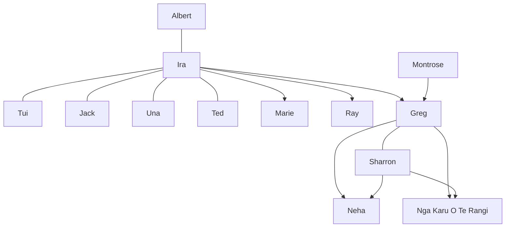

# Family tree

[Albert Skipper](albert-skipper/README.md) is the root. A wife or partner opens a branch for their own parents and siblings. Children stay on their parent's line. The fuller record for each person stays in [people](../people/README.md).

- [Albert Skipper](albert-skipper/README.md)
  - [Ascendants](albert-skipper/ascendants.md)
  - [Ira Skipper](ira-skipper/README.md), his wife
    - [Her ascendants and siblings](ira-skipper/ascendants.md)
    - [Marie Skipper](ira-skipper/marie-skipper.md)
    - [Ray Skipper](ira-skipper/ray-skipper/README.md)
      - [Jan](ira-skipper/ray-skipper/jan/README.md), his partner
    - [Greg Skipper](ira-skipper/greg-skipper/README.md)
      - [Montrose](ira-skipper/greg-skipper/montrose.md), his father
      - [Sharron Skipper](ira-skipper/greg-skipper/sharron-skipper/README.md), his wife
        - [Her ascendants](ira-skipper/greg-skipper/sharron-skipper/ascendants.md)
      - [Neha Skipper](ira-skipper/greg-skipper/neha-skipper.md)
      - [Nga Karu O Te Rangi Skipper](ira-skipper/greg-skipper/karu-skipper.md)
